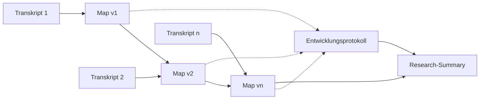

[README.md](https://github.com/user-attachments/files/34439756/README.md)
# UX-Research-Skills für KI-Assistenten

Zwei Agent Skills im offenen SKILL.md-Format, die die Auswertung qualitativer Nutzer:innen-Interviews unterstützen – von der Affinity Map bis zur Übergabe der Ergebnisse. Beide arbeiten mit Markdown-Dateien, die sich gut in [Obsidian](https://obsidian.md) lesen und verlinken lassen.

| Skill | Was er macht |
|---|---|
| [`affinity-mapping`](./affinity-mapping) | Baut aus Interviewtranskripten Schritt für Schritt eine Affinity Map – vom Datenpunkt bis zum Insight – und dokumentiert, wie sie sich mit jedem Interview verändert |
| [`research-summary`](./research-summary) | Verdichtet die finale Map und ihr Entwicklungsprotokoll zu einer kompakten Research-Summary als Übergabedokument |

> Die Skills sind auf Deutsch geschrieben und erzeugen deutschsprachige Ergebnisse (geschlechterinklusiv mit Doppelpunkt). Bei Transkripten in anderen Sprachen arbeiten sie in deren Sprache.

---

## Grundhaltung: Menschen forschen, die Skills unterstützen

**Interviews führen immer Menschen** – Menschen, die gute Fragen stellen und gut zuhören. Nachfragen, Pausen aushalten, Zwischentöne wahrnehmen und Vertrauen aufbauen kann kein Skill übernehmen.

Die Skills ersetzen die Auswertung durch Menschen **nicht**. Sie sollen:
- die Auswertung **erleichtern**, wenn für ein gemeinsames Affinity Mapping im Team zu wenig Zeit ist
- die **Qualität gegenüber einfachen Transkript-Summaries erhöhen**, weil das Material mehrstufig, nachvollziehbar und gegen das Original geprüft verdichtet wird

Maps und Summaries sind Arbeitsstände. Die Deutungshoheit bleibt bei den Menschen, die die Interviews geführt haben.

## Einwilligung & Datenschutz

- **Aufzeichnung nur mit Einwilligung:** Interviews werden nur aufgezeichnet und transkribiert, wenn alle Gesprächspartner:innen vorher informiert eingewilligt haben – auch in die Auswertung mit KI.
- **Datenschutz mitdenken:** Transkripte nur in dafür freigegebenen KI-Werkzeugen verarbeiten, identifizierende Angaben möglichst vor dem Upload entfernen, sensible Inhalte nicht unnötig übernehmen, Ergebnisse geschützt ablegen und fristgerecht löschen.

Details stehen in den READMEs der beiden Skills. Diese Hinweise ersetzen keine Rechtsberatung – im Zweifel die zuständigen Datenschutzbeauftragten einbeziehen.

---

## Wie die Skills zusammenspielen



1. **`affinity-mapping`** startet mit dem ersten Transkript (v1) und arbeitet jedes weitere einzeln ein. Jede Version wird gegen die Transkripte geprüft; alle Änderungen landen im Entwicklungsprotokoll.
2. **`research-summary`** nimmt die finale, geprüfte Map und das Entwicklungsprotokoll und erstellt daraus die Übergabe an Team, Auftraggeber:innen oder einen Workshop.

---

## affinity-mapping

**Ebenen**

| Ebene | Inhalt |
|---|---|
| L0 Datenpunkt | atomares Zitat oder gekennzeichnete Paraphrase mit ID und Fundstelle |
| L1 Voice of the Customer | Cluster aus Datenpunkten, Titel als Insight in Ich-Form („Ich möchte …, damit …“) |
| L2 Insight-Cluster *(optional)* | übergeordneter Insight in Ich-Form |
| L3 Thema *(optional)* | thematische Headline |

**Kernfunktionen**
- **Jobs to be Done** nach Clayton Christensen als Referenzrahmen: Jeder Insight ist einer oder mehreren Dimensionen zugeordnet – funktional, sozial, emotional – inklusive Coverage-Check
- **Schrittweiser Aufbau:** pro Transkript eine neue Version, Markierungen für neue, bestätigte, veränderte und widersprochene Insights
- **Entwicklungsprotokoll:** beschreibt auf einer Metaebene, wie sich die Map verändert – stabile, volatile und spät entstandene Insights, Insight-Lebensläufe, Sättigung
- **`re-cluster`:** dieselben Datenpunkte unter einer neuen Linse neu ordnen (z. B. Spannungen, Journey, Forces of Progress)
- **Qualitätssicherung:** Zitatabgleich per Skript und Prüfung jedes Datenpunkts, jeder Verdichtung und aller Zählungen gegen das Original – damit nichts halluziniert wird

**Befehle**

| Befehl | Beispiel |
|---|---|
| Map starten | „/affinity-mapping – Projekt XY, Forschungsfrage: …, hier das erste Transkript“ |
| Transkript hinzufügen | „Nächstes Transkript einarbeiten“ |
| re-cluster | „Bitte re-cluster, Linse: Spannungen & Widersprüche“ |
| QS | „Bitte QS für v3 laufen lassen“ |

→ [Ausführliche README](./affinity-mapping/README.md)

## research-summary

**Aufbau der Summary**
- Auf einen Blick
- Forschungsfrage und Basis
- 5–8 Top-Insights mit Belastbarkeit, Belegzitaten und Begründung der Auswahl
- Jobs-to-be-Done-Überblick
- Wie sich das Bild entwickelt hat
- Spannungen und Widersprüche
- Was gut funktioniert
- Handlungsfelder als „Wie könnten wir …?“-Fragen
- Offene Fragen und blinde Flecken

**Grundregeln**
- Nichts Neues behaupten: Jede Aussage hat eine Insight-ID und ist in die Map verlinkt.
- Zitate werden wortgleich aus der Map übernommen.
- Problemraum statt Lösung: Handlungsfelder sind Fragen, keine Maßnahmen.

**Varianten:** One-Pager, Workshop-Vorbereitung, angepasst an eine Zielgruppe.

→ [Ausführliche README](./research-summary/README.md)

---

## Erzeugte Dateien

| Datei | Skill | Inhalt |
|---|---|---|
| `affinity-map_<projekt>_v<n>.md` | affinity-mapping | eine Map-Version pro Schritt, Vorversionen bleiben unverändert |
| `map-entwicklung_<projekt>.md` | affinity-mapping | fortlaufendes Entwicklungsprotokoll |
| `transkript_<projekt>_T<nn>.txt` | affinity-mapping | gesichertes Transkript, falls es in den Chat eingefügt wurde |
| `research-summary_<projekt>_v<n>.md` | research-summary | Summary auf Basis der Map-Version n |

Alle Dateien im selben Obsidian-Vault ablegen: Dann führen Links von der Summary über den Insight bis zum einzelnen Zitat.

---

## Installation

Jeder Skill ist ein Ordner mit einer `SKILL.md` (die Anweisungen für das Modell) und einer `README.md` (die Dokumentation für Menschen).

```
affinity-mapping/
├── SKILL.md
└── README.md
research-summary/
├── SKILL.md
└── README.md
```

- **Claude (Web/Desktop):** den jeweiligen Ordner als ZIP packen und in den Skill-Einstellungen hochladen.
- **Claude Code:** die Ordner in das Skills-Verzeichnis kopieren, z. B. `~/.claude/skills/`.
- **Andere Tools mit Agent-Skills-Unterstützung:** die Ordner in das Skills-Verzeichnis des jeweiligen Tools legen – wo das liegt, steht in dessen Dokumentation.
- **Tools ohne Skill-Unterstützung:** den Inhalt der `SKILL.md` als Anweisung bzw. Projekt-Prompt hinterlegen.

Je nach Tool lassen sich die Skills per Befehl (z. B. `/affinity-mapping`) aufrufen oder werden automatisch genutzt, wenn eine Anfrage zur `description` passt.

---

## Kompatibilität

Die Skills nutzen das offene [Agent-Skills-Format](https://agentskills.io) (`SKILL.md` mit `name` und `description`), das neben Claude inzwischen von vielen KI- und Coding-Tools unterstützt wird, etwa OpenAI Codex, GitHub Copilot, Cursor oder Gemini CLI. Der Inhalt ist reiner Anweisungstext und an kein bestimmtes Modell gebunden.

Wie gut sie laufen, hängt von den Fähigkeiten der Umgebung ab:

| Fähigkeit | Wofür | Ohne diese Fähigkeit |
|---|---|---|
| Dateien lesen und schreiben | Maps, Entwicklungsprotokoll und Summary als Dateien ablegen | Ausgabe als Markdown-Codeblock zum manuellen Speichern; Vorversionen müssen jeweils wieder bereitgestellt werden |
| Code ausführen (Python) | automatischer Zitatabgleich in der QS | manueller Abgleich, im QS-Bericht vermerkt – weniger zuverlässig |
| Subagenten | QS durch eine unabhängige Prüf-Instanz | Prüfung in einem eigenen Durchgang durch dasselbe Modell |
| Großes Kontextfenster | lange Transkripte und umfangreiche Maps | Transkripte ggf. aufteilen |

**Empfehlung:** Am besten funktionieren die Skills in agentischen Umgebungen, die Dateien schreiben und Code ausführen können – zum Beispiel Coding-Tools, die direkt im Obsidian-Vault arbeiten. Die Qualität von Insight-Formulierungen und Zitattreue unterscheidet sich je nach Modell; vor dem Einsatz mit echten Daten in jedem neuen Tool erst mit einem anonymisierten Transkript testen.

**Datenschutz:** Jedes Tool bedeutet einen eigenen Anbieter, der die Daten verarbeitet. Die Freigabe für echte Transkripte ist für jedes Tool einzeln zu klären.

---

## Feedback

Die Skills sind in Erprobung. Erfahrungen, Fehler und Ideen gern als Issue oder Pull Request – besonders interessant: Wo weicht die Map von eurer eigenen Auswertung ab, und was hat die QS übersehen?

---

## Lizenz

[](https://creativecommons.org/licenses/by/4.0/)

Diese Skills stehen unter der [Creative Commons Namensnennung 4.0 International (CC BY 4.0)](https://creativecommons.org/licenses/by/4.0/deed.de). Den vollständigen Lizenztext findest du in der Datei [`LICENSE`](./LICENSE).

Du darfst die Skills teilen, anpassen und weiterentwickeln, auch kommerziell, solange du die Urheberschaft nennst, einen Link zur Lizenz angibst und kenntlich machst, ob du Änderungen vorgenommen hast. Zum Beispiel so:

> „affinity-mapping“ und „research-summary“ von Hias Wrba, lizenziert unter [CC BY 4.0](https://creativecommons.org/licenses/by/4.0/). Angepasst von …

**Autor:** Hias Wrba
